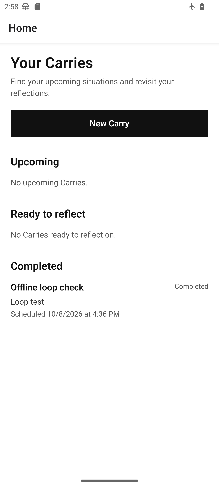
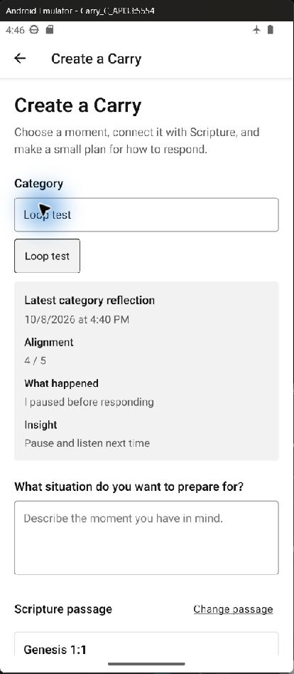

# Carry

Carry is designed to help users connect Scripture with everyday situations:
choose a passage, plan an action, and reflect afterward.

An Android app built with React Native, Expo, and TypeScript for COMP826 Milestone 2.

[Try the app](#try-the-app) · [Run from source](#run-from-source) · [Checks](#checks) · [Evidence](#documentation-and-evidence)

Features include offline [World English Bible](https://ebible.org/engwebp/) browsing
and reference lookup, editable plans, local reminders, saved reflections and
reuse of a category's latest reflection.

<table>
  <tr><th>Home</th><th>Previous reflection in a new plan</th></tr>
  <tr>
    <td></td>
    <td></td>
  </tr>
</table>

Screenshots are from recorded emulator checks.

## Try the app

1. Download **[Carry.apk](https://github.com/eirikenriquez/Carry/releases/download/v1.0.0-evaluation/Carry.apk)**
   from the [evaluation release](https://github.com/eirikenriquez/Carry/releases/tag/v1.0.0-evaluation).
2. Install and open it on Android 7.0 or later. For an Android Studio emulator,
   drag the downloaded APK onto its window.
3. No account, server or development tools are needed on a phone. Bundled Scripture
   and saved records are available offline.

If phone security blocks installation, use an emulator or contact the developer
rather than disabling security. iPhone is not supported.

### Short walkthrough

Use fictional information for testing.

1. Tap **New Carry**, choose a book/chapter, select verses and confirm the passage.
2. Enter category **Demo**, a situation, an if-then plan and a time a few minutes
   ahead. Save and reopen the Carry. Upcoming Carries can also be edited or deleted.
3. After its situation time, return to Home and open the **Ready to reflect** Carry.
   Enter a rating, what happened and an insight, then save.
4. Start another Carry and use category **Demo** to see the previous reflection.
   Cancel this draft if you do not want to save it.

For a **reminder demo**, use a situation at least 20 minutes ahead and allow
notifications when prompted. The reminder is scheduled 15 minutes before the
situation; tap it to reopen the Carry. A near-term reflection demo will not schedule
a reminder once that offset has passed.

## Run from source

### Requirements

- Git
- Node.js 24 and npm
- Android Studio with an Android SDK and emulator
- JDK 20 was used for the recorded native builds; `JAVA_HOME` must point to the JDK
- Python 3, only for the source-data check

Start an Android emulator, then run in PowerShell:

```powershell
git clone https://github.com/eirikenriquez/Carry.git
Set-Location Carry
npm ci
$env:ANDROID_HOME = "$env:LOCALAPPDATA\Android\Sdk"
npm run android
```

If using the submitted ZIP or an existing clone, open the project folder containing
`package.json` and start at `npm ci`.

The first run builds and installs the Expo development app and starts Metro.
For later JavaScript or TypeScript changes, run `npm run start` and press `a`.
Rebuild after native dependency or Expo configuration changes; use the development
build, not Expo Go, for native verification.

A standalone release APK contains its own code and runs without Metro. To see
updated code in that version, install a newly built APK on the emulator; starting
Metro alone will not update it.

## Checks

```powershell
npm run format:check
npm run lint
npm run typecheck
npm test -- --runInBand
npm run test:bible
npm run test:carry
python scripts/test_bible_data.py
```

`test:bible` checks the Bible repository; `test:carry` checks personal storage
against real SQLite. Node's experimental SQLite warning is expected.
Python checks the data against the publisher export.

## Documentation and evidence

| What to inspect | Where |
| --- | --- |
| Architecture, diagram and Bible source | [Architecture](docs/architecture.md) |
| Recorded automated and installed-app checks | [Test log](docs/test-log.md) |
| Criteria, methods and results | [Evaluation](docs/evaluation.md) |
| De-identified responses | [Participant sheets](docs/evidence/participants/README.md) |
| Touch, contrast and enlarged-text findings | [Interface checks](docs/evaluation.md#interface-checks) |
| Coding conventions | [Coding standards](docs/coding-standards.md) |

## Scope

Android portrait prototype. Lookup supports full book names, not keyword search,
abbreviations or cross-chapter ranges. Testing provides partial evidence, not a full
reliability or accessibility pass; see the [criterion statuses](docs/evaluation.md#criteria-status).
