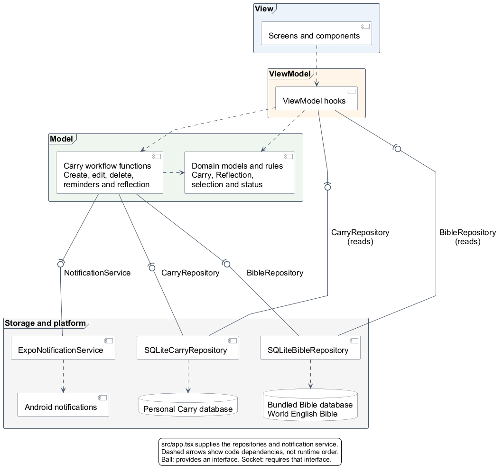

# Architecture

Carry uses lightweight MVVM with Repository and Service boundaries. Views render
state, ViewModels handle interaction, and interfaces isolate SQLite and Expo notifications.

## Component diagram

[PNG](diagrams/component-diagram.png) | [PlantUML source](diagrams/component-diagram.puml)

The diagram shows dependencies, not execution order. `src/app.tsx` supplies the
concrete repositories and notification service.

## Structure and Milestone 1 changes

| Location | Responsibility |
| --- | --- |
| `src/app.tsx`, `src/navigation` | Startup, dependency wiring, screens and reminder-tap routing |
| `src/screens`, `src/components` | Interface and reusable form fields |
| `src/view-models` | Drafts, loading, validation feedback and actions |
| `src/models` | Entities, validation and status rules |
| `src/services` | Application workflows and notification adapter |
| `src/repositories` | Repository interfaces, SQLite adapters and database setup |

- Milestone 1's larger lifecycle service became smaller workflow functions.
  ViewModels also read directly through repository interfaces.
- A flatter, Ignite-inspired layout replaced deeply nested folders without
  changing the MVVM boundaries. Screens and ViewModels do not call SQLite or
  Expo Notifications directly.
- Tests sit beside the code they check. File conventions are in
  [coding standards](coding-standards.md).

The diagram uses [provided/required interfaces](https://www.ibm.com/docs/en/dma?topic=diagrams-interfaces)
and [PlantUML connectors](https://plantuml.com/deployment-diagram).
[MVVM responsibilities](https://learn.microsoft.com/en-us/dotnet/architecture/maui/mvvm)
are adapted to React hooks rather than classes.

## Key decisions

- Separate databases keep bundled Scripture read-only and personal records writable.
  Carries store verse keys rather than copies of passage text.
- Category names match ignoring case and repeated whitespace. Category and Carry
  creation share a transaction; SQLite foreign keys protect relationships.
- Status is calculated from the schedule and optional reflection. It refreshes
  on focus, loading and app resume, not continuously.
- Reflections are insert-only. Category reuse displays the newest reflection by
  reflection creation time, without copying it into the new plan.
- ViewModels retain drafts and guard repeated saves or stale asynchronous results.
  New Carry currently opens Scripture before the form; changing passage preserves
  other fields. Explicit Cancel returns Home.
- Saving a Carry and scheduling Android reminders are separate operations.
  Permission or scheduling failure keeps the Carry and shows feedback. Edits
  replace reminders; deletion requests cancellation. Notifications carry the
  Carry ID so taps reopen its detail screen.

## Storage and source data

- Source: [eBible.org Protestant World English Bible](https://ebible.org/engwebp/)
  (`engwebp`, American spelling), retrieved 1 October 2026; XML dated 28 September 2026.
- The text is public domain; World English Bible is a trademark. See the
  [publisher's rights notice](https://ebible.org/engwebp/copyright.htm).
- [Retained VPL archive](../data/bible/engwebp_vpl.zip) and
  [import script](../scripts/build_bible.py) reproduce the
  [bundled database](../assets/bible/web-2026-09-28.db). The script verifies the
  pinned archive hash. There is no runtime Scripture download.
- Dataset: 66 books, 1,189 chapters and 31,103 entries. Five publisher-provided
  entries are empty: Luke 17:36, Acts 8:37, Acts 15:34, Acts 24:7 and Romans 16:25.
  Export whitespace is trimmed; notes, headings and formatting are not imported.
- Personal storage holds categories, Carries and reflections, with UTC dates.
  Deleting a Carry removes its reflection but retains its category. Unknown or
  damaged schemas fail without resetting user data.

Recorded verification and evaluation limits are in the [test log](test-log.md)
and [evaluation](evaluation.md).
